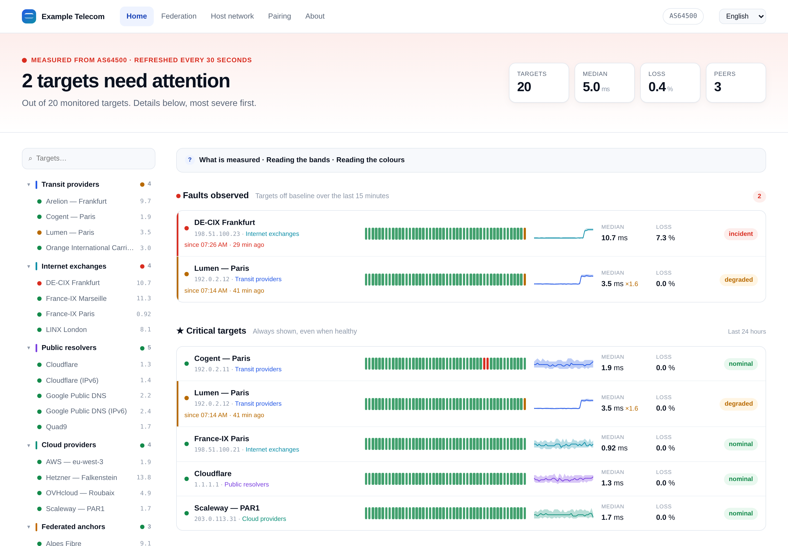
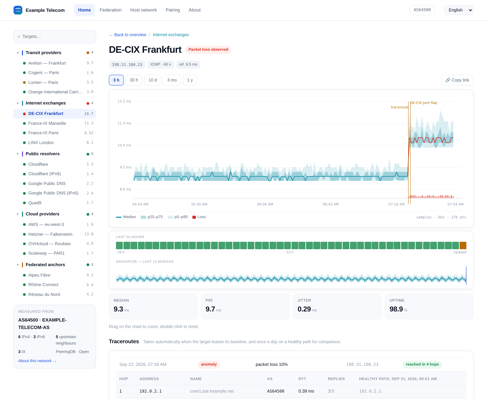
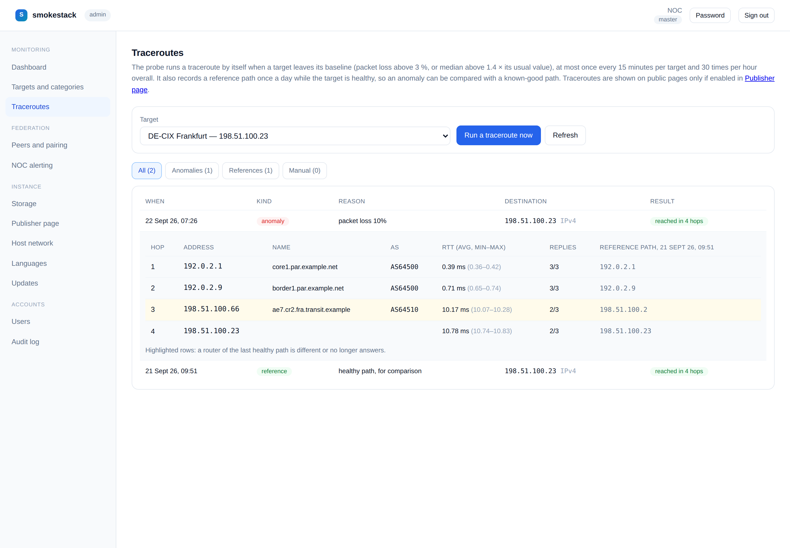
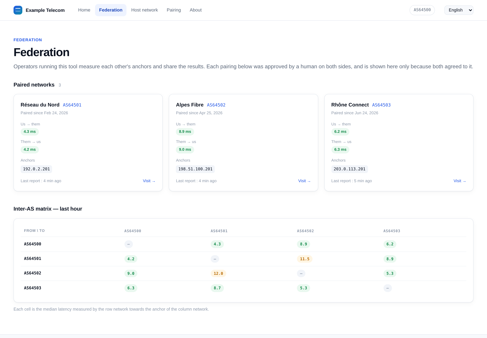
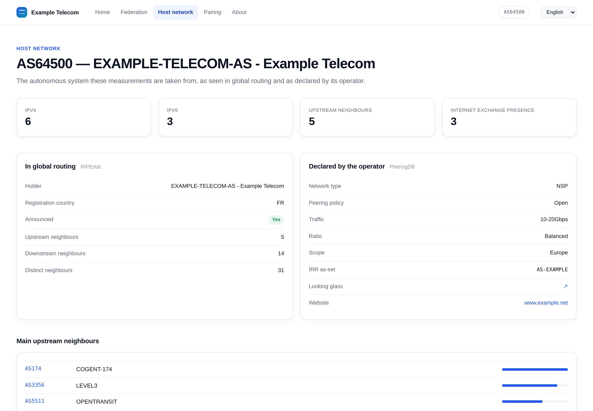
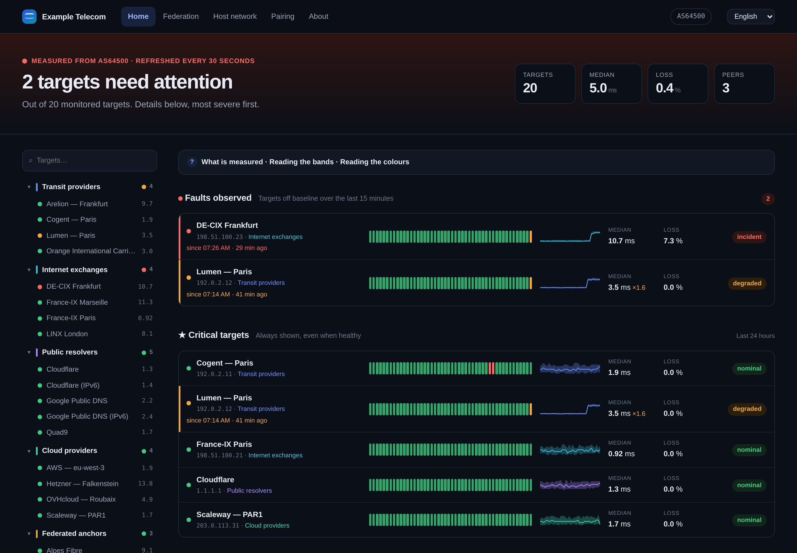
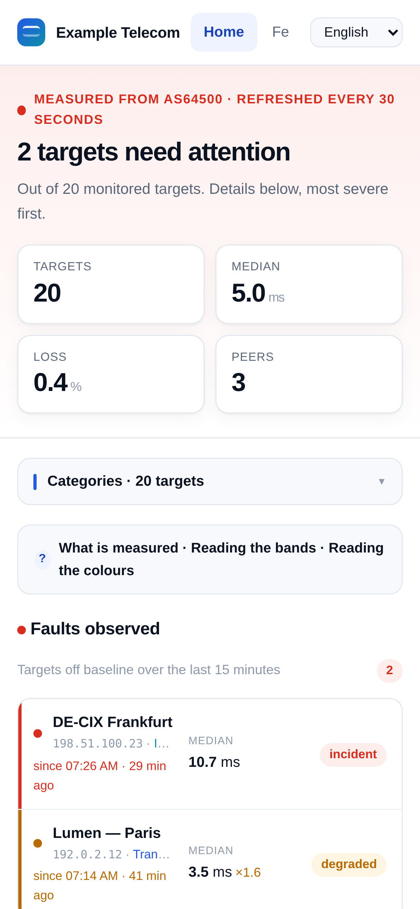

# smokestack

[](https://github.com/nkglfr/smokestack/actions/workflows/ci.yml)
[](https://github.com/nkglfr/smokestack/releases/latest)
[](LICENSE)

**Public latency monitoring for network operators.** A modern take on
SmokePing: one binary, fast graphs, exact percentiles, and a federation
between operators who measure each other.

- 📈 **Latency, jitter and loss** to your transits, exchanges, DNS resolvers and clouds
- 🔍 **Zoom from one year down to 30 seconds**, percentiles stay exact at every level
- 📍 **Measure from several places**: probes on your other sites report to one instance, and a target says which of them decides its status
- 🧭 **Traceroute on anomalies**, compared with the last healthy path, over IPv4 and IPv6
- 🌍 **Public status page in 10 languages**, with a private back-office
- 🤝 **Federation**: pair with other operators, measure each other, get notified of incidents
- 📦 **One static binary**, SQLite inside, optional S3 archive, installs in under a minute



---

## Quick start

On any Linux server with systemd (amd64 or arm64):

```sh
curl -fsSLO https://github.com/nkglfr/smokestack/releases/latest/download/install.sh
sudo sh install.sh --admin-email noc@example.net
```

Already root, as on a fresh Debian? Drop `sudo`. The installer prints the
back-office address and the admin password.

**Or with Docker**, for a test:

```sh
docker run -d --network host --cap-add NET_RAW \
  -v smokestack-data:/var/lib/smokestack ghcr.io/nkglfr/smokestack:latest
```

> ⚠️ **Containers measure less accurately.** `--network host` is mandatory:
> on Docker's default bridge every probe crosses a NAT that adds latency and
> jitter, traceroutes start with a bogus first hop, and IPv6 is off. On macOS
> and Windows, Docker runs in a virtual machine, so you measure that machine
> and not your network. A container also has no signed in-place updates and
> no automatic rollback. For published measurements, prefer the native
> install above. Full disclaimer:
> [DEPLOY.md § 12](DEPLOY.md#12-container-image-tests).
>
> The service detects this by itself: started in a container, it says so in
> its log, and the back-office shows a banner naming what is degraded.

On a first installation the installer asks for the listen IP and port;
press Enter to keep the default, `127.0.0.1:8080` (this machine only). You can
also give them directly, for instance `--ip 0.0.0.0 --port 80` to reach the
interface from your network while testing, and `--yes` skips all questions. For production, put a TLS reverse proxy in
front, for example with Caddy:

```
latency.example.net {
    reverse_proxy 127.0.0.1:8080
}
```

Then open `https://latency.example.net/admin`, set your AS number and add
your targets.

**To add a probe on another machine**, issue it a token on the instance
(*Instance → Probes*, or `smokestack probe add -slug lyon-1 -token`), then on
that machine:

```sh
curl -fsSLO https://github.com/nkglfr/smokestack/releases/latest/download/install.sh
sudo sh install.sh --probe-only --server https://latency.example.net --token THE-TOKEN
```

That installs the probe and nothing else: no web service, no database, no
admin account. It measures nothing until you assign it targets:
[DEPLOY.md § 14](DEPLOY.md#14-probes-on-other-machines).

📘 Full guide: **[DEPLOY.md](DEPLOY.md)** · What's new: **[CHANGELOG.md](CHANGELOG.md)** (HTTPS, updates, backups, troubleshooting).

---

## Screenshots

<table>
<tr>
<td width="50%"><a href="docs/screenshots/detail.png"></a></td>
<td width="50%"><a href="docs/screenshots/traceroutes.png"></a></td>
</tr>
<tr>
<td align="center"><b>Target detail</b><br>Percentile bands, loss bars, events, zoom from one year down to 30 seconds</td>
<td align="center"><b>Traceroute on anomalies</b><br>Taken automatically, compared hop by hop with the last healthy path</td>
</tr>
<tr>
<td width="50%"><a href="docs/screenshots/federation.png"></a></td>
<td width="50%"><a href="docs/screenshots/network.png"></a></td>
</tr>
<tr>
<td align="center"><b>Federation</b><br>Operators measure each other, latency in both directions, inter-AS matrix</td>
<td align="center"><b>Host network</b><br>Your AS as seen in global routing (RIPEstat) and declared on PeeringDB</td>
</tr>
<tr>
<td width="50%"><a href="docs/screenshots/home-dark.png"></a></td>
<td width="50%" align="center"><a href="docs/screenshots/mobile.png"></a></td>
</tr>
<tr>
<td align="center"><b>Dark theme</b><br>Follows the visitor's system setting</td>
<td align="center"><b>Mobile</b><br>Responsive, faults first</td>
</tr>
</table>

<sub>Screenshots use a demo data set: fictitious operators and documentation addresses (RFC 5737, RFC 3849, RFC 5398).</sub>

---

## Why smokestack

| | SmokePing | smokestack |
|---|---|---|
| Graphs | Rendered on the server at every page view | Drawn in the browser, from pre-aggregated data |
| Percentiles over long periods | Averaged (inaccurate) | Merged histograms (exact) |
| Measurements under server load | Skewed | Kernel timestamps, isolated probe process |
| Storage | RRD files | SQLite + optional S3 archive of raw data |
| Measuring from several places | Master/slave, shared secret, slaves listed in the config file | Probes enrolled from the back-office, one token each, targets assigned per probe |
| Deployment | Perl, fping, rrdtool, web server | One binary |
| Updates | Manual | Signed packages, one click, automatic rollback |

---

## How it works

```
                  Unix socket                    HTTPS
 ┌───────────────┐  targets  ┌──────────────────┐  ┌──────────────────┐
 │ smokestack    │◄──────────│ smokestack       │─►│ reverse proxy    │─► visitors
 │ probe (local) │──────────►│ web service      │  │ (Caddy, nginx)   │
 │ ICMP/TCP/UDP  │ results   │ API · UI · SQLite│  └──────────────────┘
 └───────────────┘           └───┬─────────┬────┘
  CAP_NET_RAW only               │         │ hourly raw archive
  high CPU priority              │         ▼
                                 │       S3 (optional)
          HTTPS + probe token    │
 ┌───────────────┐               │
 │ smokestack    │◄──────────────┘   another site, another city, another AS
 │ probe (remote)│  the targets it was assigned, and the results it measured
 └───────────────┘
```

- **The probe runs in its own process.** It is the only one allowed raw
  sockets, it has CPU priority, and replies are timestamped by the kernel.
  Heavy traffic on the website cannot distort a measurement.
- **Probes can run anywhere.** A probe on another machine speaks the same
  protocol over HTTPS, authenticated by a token it is issued, and is given
  only the targets it was assigned. Each target names the probe that decides
  its status, and the probes to fall back to while that one is silent.
- **Percentiles are exact at every zoom level.** Each measurement is stored
  as a small mergeable histogram (DDSketch, 1 % relative error), rolled up
  into 1 min, 5 min, 1 h and 1 day buckets.
- **The right resolution is picked automatically** from the time window you
  look at: raw samples for a few hours, daily buckets for years.
- **Disk usage is bounded.** Raw data is archived hourly to S3 or kept
  locally with a quota; long-term aggregates are never evicted.

Benchmark on one saturated CPU core, loopback targets (true RTT ≈ 0.03 ms):
under web load the probe measures **0.016 ms median, 0.041 ms worst**,
versus 1.7 ms and 50 ms with a naive single-process design.
Details in [DEPLOY.md § 10](DEPLOY.md#10-probe-isolation-and-performance).

---

## Features

**Public site**
- Status overview: faults first, critical targets, all categories
- 24-hour status bar and sparkline per target
- Detail view with drag-to-zoom, 1-year navigator, event annotations, permalinks
- A choice of vantage point where the instance has several probes: the graph, the availability figure,
  the traceroutes and the AS path all follow it, and the choice travels in the link you share
- Anomaly traceroutes marked on the graph (optional, off by default)
- Availability over 24 h, 7 d, 30 d and 1 y, counted in measurement passes rather than packets, with
  the definition and the "this is not an SLA" caveat next to the figure rather than in a footnote
- Host network page: your AS from RIPEstat and PeeringDB
- Federation page: paired networks and inter-AS latency matrix
- Light and dark themes, responsive, in 10 languages (the visitor's browser language is picked automatically)

**Back-office**
- Accounts with four roles (viewer, editor, admin, master) and an audit log
- Targets and categories, ICMP, TCP or UDP echo, IPv4 or IPv6, every 30 s, 1, 5 or 10 min
- A catalogue of ready-made targets to enable in one click, plus per-country
  suggestions in the [wiki](https://github.com/nkglfr/smokestack/wiki)
- A contact form on the public pages, so your address stays off spam lists
- Alerts on your own targets after a sustained incident, traceroute included
- TLS certificate watch on every TCP target: expiry warned 30, 14, 7 and 1 day ahead, and a refused
  certificate — wrong name, unverifiable chain, broken handshake — reported as soon as it is seen
- Response-time breakdown on demand for a TCP target: name resolution, TCP connection and TLS
  handshake timed separately, back-office only and never historised
- Maintenance calendar: declare a window and choose whether it silences alerting, stops the
  measurement, or both — the public page carries a banner, and a stopped window is excluded from
  the availability figure instead of counting as an outage
- Indexable public pages: titles, descriptions, readable addresses per target,
  sitemap and a summary that works without JavaScript
- Public or **private** targets: private ones are measured and visible in the back-office only
- Traceroutes: automatic on anomalies, daily reference path, on demand, with path comparison
- Storage settings (local quota or S3), publisher page, languages
- One-click updates with rollback

**Probes**
- Enrol a probe on another machine and issue it a token, shown once and stored only as a hash
- Give it an explicit list of targets, or every target including the ones added later
- Each target names the probe that decides its status, chosen among those that measure it
- An ordered list of probes to fall back to while that one is silent, with a ten-minute delay before
  it takes its targets back — coming back costs more than going away, so a flapping link cannot hand
  a target to and fro every few minutes
- A probe that stops reporting raises its own alert, and the targets it decides keep their incidents
  open rather than being announced as recovered
- When a target is in trouble, the other probes measuring it are asked what they see, and the alert
  says whether everyone sees it (the target) or only the deciding probe does (the path from there)
- Where each probe measures from: the address it connects from, or one you state when that would be
  wrong, and the AS it falls in

**Federation**
- Pairing between instances, approved by a human on both sides
- Ed25519-signed messages, fingerprints compared out of band
- Pairings shown publicly only if both operators agree
- NOC alerts only when several independent observers confirm an incident
- Double-check: a peer in another AS measures one of your targets on request, so an incident says
  whether the target is down or your own path is. Opt-in per peer, capped, and only for a target you
  already publish; the peer's measurements never enter its own data and are deleted afterwards

---

## Updating

Every release is a signed `.zip`. From the back-office (*Instance → Updates*),
the command line, or automatically:

```sh
sudo smokestack update smokestack-0.2.2-linux-amd64.zip
sudo smokestack rollback
```

The package signature, platform and checksum are verified, the new binary
tests itself, the configuration database is backed up, and the switch is
atomic. If the new version fails to start three times, the previous one is
restored automatically.

The service checks for new versions once a day (6 hours, a week or a month
are also available) and shows them in the back-office. Skipping versions is
harmless: the newest release is installed directly. Automatic installation is optional (off by default) and only
ever installs signed releases, never pre-releases. Details:
[DEPLOY.md § 5](DEPLOY.md#5-updating).

---

## Configuration

`/etc/smokestack/config.json`, written by the installer:

```json
{
  "data_dir": "/var/lib/smokestack",
  "probe": { "enabled": true, "mode": "external", "slug": "par-01", "name": "Paris",
             "traceroute": { "max_hops": 30, "reference_hours": 24 } },
  "update": { "auto_check": true, "auto_apply": false, "check_interval_hours": 24 }
}
```

The listen address has its own small file, `/etc/smokestack/smokestack.env`:

```sh
SMOKESTACK_LISTEN_IP=127.0.0.1      # * or 0.0.0.0 for all IPv4 interfaces, :: for IPv4 and IPv6
SMOKESTACK_LISTEN_PORT=8080
```

Edit it, then `systemctl restart smokestack`. The same settings exist as
flags (`-ip`, `-port`) and in `config.json` (`listen_ip`, `listen_port`);
flags win over environment variables, which win over `config.json`.

On a machine installed with `--probe-only`, the same file carries where to
report and the token to prove it is the probe it says it is, and nothing
else:

```json
{
  "data_dir": "/var/lib/smokestack",
  "probe": { "enabled": true, "mode": "external", "slug": "lyon-1", "name": "lyon-1",
             "server": "https://latency.example.net", "token": "..." }
}
```

The URL must be `https`: the token travels on every request and the target
list comes back on the same connection, so the probe refuses to start on
plain http rather than warning in a log nobody reads.

Everything else (targets, storage, S3, languages, federation, users) is set
from the back-office.

---

## Containers

The image is published with each release on `ghcr.io/nkglfr/smokestack`, for
amd64 and arm64, and the command is in [Quick start](#quick-start) above.

The **host network is mandatory**: on Docker's default bridge, the probes
cross a NAT that adds latency and jitter, traceroutes start with a bogus hop,
and IPv6 is off. Containers are meant for tests and for container-only
setups; for published measurements prefer the native install, which also
brings signed in-place updates and an isolated, CPU-prioritised probe. Full
disclaimer: [DEPLOY.md § 12](DEPLOY.md#12-container-image-tests).

---

## Languages

Public pages are available in:

| Code | Language | Code | Language |
|---|---|---|---|
| `en` | English (reference) | `it` | Italiano |
| `da` | Dansk | `nb` | Norsk bokmål |
| `de` | Deutsch | `nl` | Nederlands |
| `es` | Español | `pt` | Português |
| `fr` | Français | `sv` | Svenska |

The visitor's browser language is used automatically, and a selector lets
them switch. Choose the default language of your instance at install time
(`--lang fr`) or later:

```sh
smokestack languages                 # list the available languages
smokestack languages -default fr     # set the default language of public pages
```

Adding a language is a single JSON file, without rebuilding: see
[DEPLOY.md § 4](DEPLOY.md#4-first-steps). The back-office is in English.

---

## API

Public, read-only, JSON:

| Endpoint | |
|---|---|
| `GET /api/v1/overview` | Status of every public target |
| `GET /api/v1/tree` | Categories and targets |
| `GET /api/v1/probes` | Where this instance measures from (masked addresses) |
| `GET /api/v1/series?target=ID&from=-30h&points=600` | Percentiles and loss over time |
| `GET /api/v1/events` | Annotated events |
| `GET /api/v1/live` | Server-sent events, latest measurements |
| `GET /api/v1/asn` | Host network (RIPEstat, PeeringDB) |
| `GET /api/v1/fed/peers` | Public federation peers |
| `GET /api/v1/traceroutes?target=ID` | Traceroutes, if made public by the operator |

`series`, `availability`, `traceroutes` and the AS path take an optional
`&probe=ID` to answer from one vantage point. Without it they answer from the
instance's own probe, as they always have.

Private targets never appear in these endpoints. An authenticated call (session
cookie or `Authorization: Bearer <admin token>`) sees them, and
`/api/v1/overview?all=1` returns them too.
| `GET /healthz` | Health check |

Rate limit: 20 requests/s per client IP, bursts of 80.

---

## Building from source

Requires Go 1.26 or later, which is also the oldest release still receiving security fixes. On Debian or Ubuntu:

```sh
apt install -y git make golang-go
git clone https://github.com/nkglfr/smokestack && cd smokestack
make test
make build                              # ./dist/smokestack
sudo sh install.sh --package dist/smokestack --admin-email noc@example.net
```

### Auditing

```sh
make audit-tools                        # once: the two pinned analysers
make audit                              # gofmt, vet, staticcheck, govulncheck
```

The CI runs that as one of five parallel jobs, alongside the tests,
ShellCheck on `install.sh`, actionlint and zizmor on the workflows, and
Trivy on the container image. It also runs every Monday rather than only on
a push: a vulnerability published the day after a merge concerns a version
that is already installed somewhere, and nothing triggered by a commit would
ever mention it.

Everything the audit judges is judged for `linux`, which is what ships:
`ts_other.go` is a stub, so analysing a Mac's own target reports a comparison
in `tracer.go` that is only ever true there.

It is also judged by one named Go toolchain, `AUDIT_TOOLCHAIN` in the
Makefile, on a developer's machine as well as in the CI. govulncheck reports
standard library vulnerabilities for the Go it runs under, so an audit that
used whatever `go` happened to be on the machine would report on a standard
library no release is built with — in either direction, and without saying
so. The CI matches `go.mod` by construction; naming the version is what makes
a local run say the same thing, at the cost of one toolchain download on a
machine with a different Go.

### Releasing

```sh
make release-key                        # once: signing key pair (see DEPLOY.md § 6)
git tag v0.2.2 && git push origin v0.2.2
```

Pushing the tag is all it takes: GitHub Actions runs the tests, builds linux/amd64 and linux/arm64,
signs the packages and publishes the release (do not create the release by hand in the GitHub
interface). Instances with automatic updates install it within a few hours.

The same workflow also runs from *Actions → release → Run workflow*, with the version as its input:
it creates the tag itself and then takes exactly the same path, so nothing can differ between the
two doors. That one waits for a reviewer of the `release` environment before it does anything, which
is what makes it safe to leave in the hands of whoever prepared the release rather than whoever
holds a shell. Set the environment up once in *Settings → Environments → release* with yourself as a
required reviewer; without it the dispatched run publishes as soon as it is started.

See [DEPLOY.md § 6](DEPLOY.md#6-publishing-your-own-releases).

---

## Security

**Found something?** Report it privately — *Security → Report a vulnerability* — rather than in an issue or a pull request, which discloses the finding and the affected version to everybody before any instance has upgraded. What is in scope, what helps in a report, and how contributions on the security path are handled: [SECURITY.md](SECURITY.md).

- The web interface is embedded in the binary: no document root, databases
  and keys are never reachable over HTTP.
- The first admin account requires a one-time setup code.
- The web service has no raw-socket privilege; the probe has nothing else.
- Hardened systemd units: read-only system, private `/tmp`, no new privileges.
- Updates must be signed by a trusted Ed25519 key.
- Dependencies, the standard library and the container base are scanned for
  published vulnerabilities on every commit and again every week; the scan
  fails if the base image has stopped receiving security updates, since a
  clean report from an unmaintained distribution means nothing.

---

## Status

Working and tested, not yet 1.0. Known gaps:

- IPv6 has been tested with crafted packets only so far; feedback from dual-stack hosts is welcome
- Latency-triggered traceroutes are covered by unit tests; loss-triggered ones were tested on a multi-hop lab network
- Remote probes have been exercised against a loopback service and in unit tests, not yet across a real network at scale
- With many probes, the home page and the alerting loop each build one view per probe; fine for a handful, not yet measured beyond that
- The public pages show one vantage point at a time: there is no side-by-side comparison and no map of where the probes are

Design notes: [docs/DESIGN.md](docs/DESIGN.md) (French version: [DESIGN.fr.md](docs/DESIGN.fr.md)).

---

## License

smokestack is released under the [Apache License 2.0](LICENSE).
